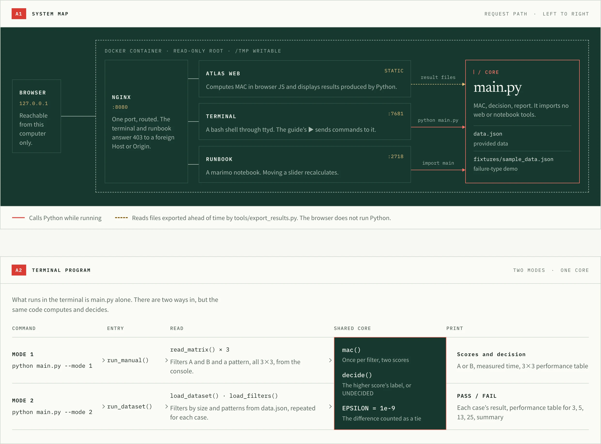
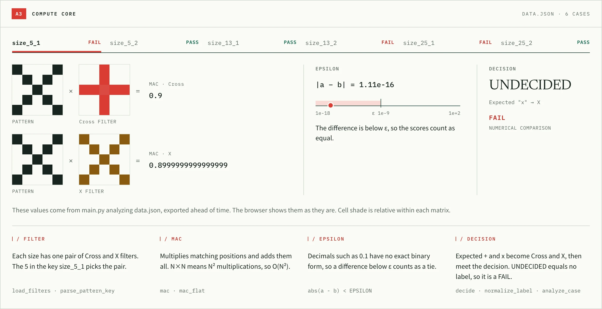
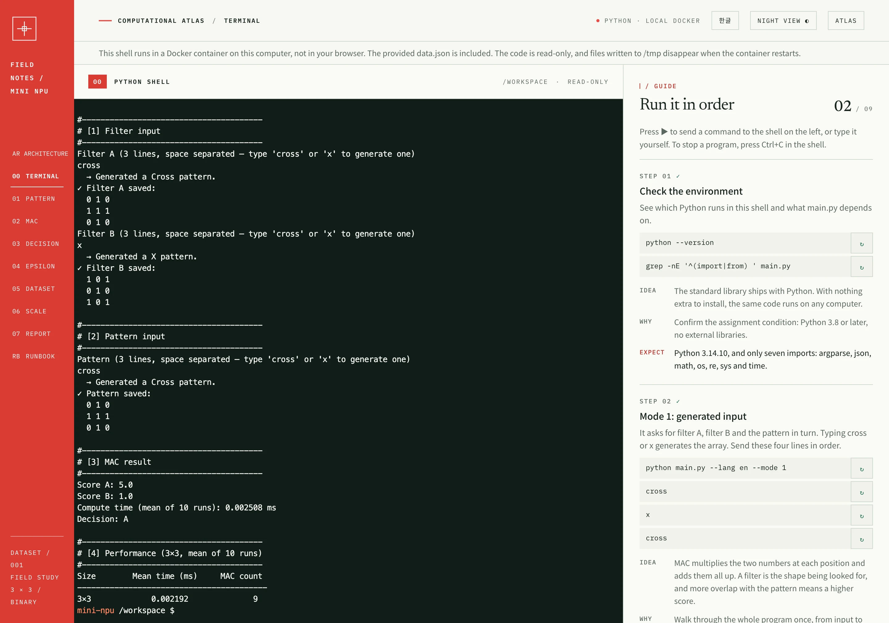
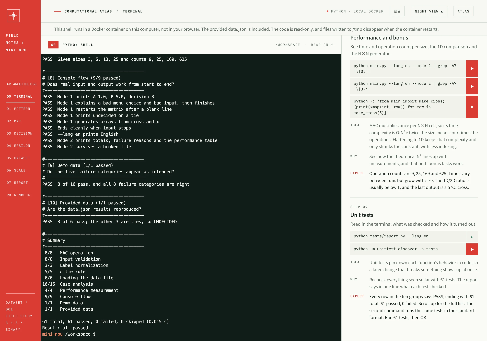

# Mini NPU: a small calculator that imitates how AI computes

[한국어](README.md) · **English**

A console program that compares numeric patterns from 3×3 to 25×25 against filters using **MAC (Multiply-Accumulate)** and decides between Cross and X. The repository holds two independent results.

| Result | Location | Requires |
|---|---|---|
| **A. Assignment program** | `main.py` | Python 3.8+, standard library only |
| **B. Rain Atlas learning material** (simulator, terminal, runbook, Manim films) | Docker image `jidoil/mini-npu-atlas` | Docker |

`main.py` does not import the web code, notebook tools or Manim. This repository holds only the code of A; B ships as an image, without its source. A works without ever pulling the image.

> **About the data**: results were measured on the provided assignment data, `data.json` (6 cases). The hand-made `fixtures/sample_data.json` (16 cases) is a demo for checking the five failure types and is not official data.

## Screens

Captured from the public image `jidoil/mini-npu-atlas:1.2.0`. The results shown come from the provided data.

### MAC simulator

| Day | Night |
|---|---|
|  |  |

On a phone, the matrices and the accumulator panel stack vertically.


### Chapters

**Concept, equation and Manim film.** The film is pre-rendered.


**Decision.** Blend the input from Cross to X and watch the scores and the decision boundary.


**Dataset.** Click a case to see the stage where it stopped.


**Performance.** Python measurements with a straight-line fit against N².


**Final analysis.** Failure categories and verification results.


### Architecture

One page covers the container, the path `main.py` takes in the terminal, how filters, MAC, ε and the decision relate, and the file structure. Pick a case and the provided data's real values appear along the compute path.





### Terminal

Run the assignment yourself in the real shell on the left. Press ▶ in the guide on the right to send a command to the shell; each step shows the result to expect.



The unit test step prints what each test checked, its result and a summary by group.



### Runbook

Read one cell at a time inside the site. Move a slider and Python recalculates.

| Opening | Slider and chart |
|---|---|
|  |  |

## How to run

### The assignment program

```bash
python3 main.py                        # choose a mode from the menu
python3 main.py --mode 1               # Mode 1: type 3×3 matrices
python3 main.py --mode 2               # Mode 2: analyze data.json
python3 main.py --mode 2 --lang en     # English output
python3 main.py --mode 2 --data path.json

python3 tests/report.py --lang en      # unit tests: what each one checks, and its result
python3 -m unittest discover -s tests  # the same tests in the standard format
```

- **Mode 1**: enter filter A, filter B and the pattern line by line, separated by spaces. A format error shows a message and asks for that matrix again. Typing `cross` or `x` on a line generates that array.
- **Mode 2**: reads `data.json` and prints per-case scores, decisions, PASS/FAIL, a performance table and a summary. If the file is missing, it uses the demo fixture and warns that this is not official data.

### Rain Atlas

```bash
docker compose up -d
```

The first run downloads the image (about 670 MiB compressed). It holds the site, the runbook, Manim and LaTeX.

| Address | Contents |
|---|---|
| http://localhost:8790 | Rain Atlas (Korean/English, Day/Night) |
| http://localhost:8790/architecture.html | The system, compute path and file structure |
| http://localhost:8790/terminal.html | A shell in the browser with an ordered guide (ttyd) |
| http://localhost:8790/runbook.html | The runbook, built into the site (marimo) |

To change the port, run `ATLAS_PORT=9000 docker compose up -d`. The terminal and the runbook execute code without a token, so they are published on `127.0.0.1` only and nginx refuses requests coming from other sites. **Do not make it reachable from other machines.**

If the server restarts while a runbook is open, the runbook may open with its cells not yet run. Press the **Restart** button on the page.

| Task | Command |
|---|---|
| Console program | `docker compose run --rm cli` |
| Unit test report | `docker compose run --rm cli python tests/report.py --lang en` |
| Stop | `docker compose down` |

## Terminal

Open it with `00` on the rail or `TERMINAL` in the top bar. Nine steps run in order, from checking the environment through Mode 1, Mode 2, the decision rules and performance to the unit tests.

- `data.json` in the terminal is the provided data. Each step also explains the idea, the intent and the expected result.
- The unit test step prints what each test checked, PASS or FAIL, and a summary by group.
- The shell runs in a local Docker container, not in your browser.
- The code is read-only, and files written to `/tmp` disappear when the container restarts.
- Reloading the page starts a new shell session and resets the progress. Switching language keeps the session.

## Runbook

The runbook opens **inside the site**, not in a separate window. Use `RB` on the Atlas rail or `RUNBOOK` in the top bar; language and Day/Night follow the Atlas. It is written so that anyone can follow it one cell at a time, with no math or machine-learning background.

- It goes from turning a picture into numbers through MAC, the dot product, the link to neural networks, floating point, dataset processing and time complexity, calling the real functions of `main.py`.
- It uses [marimo](https://marimo.io). Move a slider or checkbox and only the related cells recalculate, at once.
- Change a 3×3 input with checkboxes, watch the scores and decision, and render a Manim film of that input.
- The Python runs in a local Docker container, not in your browser. The container is read-only, so trying out code edits never changes the files in the image.

## Implementation summary

### MAC

Multiply the elements of input $P$ and filter $F$ at the same position and add everything up. This is neither a sliding convolution nor matrix multiplication.

```python
def mac(pattern, filter_matrix):
    n = len(pattern)
    score = 0.0
    for i in range(n):
        for j in range(n):
            score += pattern[i][j] * filter_matrix[i][j]
    return score
```

### Label normalization

Before comparing, every label becomes a canonical `Cross` or `X`. Surrounding spaces and letter case are ignored.

| Raw | Canonical |
|---|---|
| `+`, `cross` (expected, filter keys) | `Cross` |
| `x` (expected, filter keys) | `X` |
| anything else | no guessing: that case is recorded as FAIL |

### Epsilon policy

If `abs(a - b) < 1e-9`, the two scores count as equal and the result is `UNDECIDED`. In Mode 2, `UNDECIDED` can never match `expected`, so it is a FAIL. Decimals such as 0.1 are not stored exactly in binary, so `==` can call mathematically equal sums different.

### Data handling

N comes from the key (`size_13_2` → 13), which selects `filters["size_13"]`. Row counts, column counts and numeric values are checked, then MAC decides. An error in one case never stops the program: it becomes that case's FAIL with a reason.

## Result report

Environment: Docker `python:3.12-slim`, Python 3.12.16, Linux aarch64, the 6 cases of the provided `data.json`.

### Test results

- **61 unit tests pass** (Python 3.8.20, 3.12.16 and 3.14.10). `python3 tests/report.py --lang en` shows what each test checks and its result.
- JS and Python test vectors: **21/21 match**
- Provided data: **6 total, 3 passed, 3 failed**
- Demo data: **16 total, 8 passed, 8 failed** (as intended)

### Provided data results

| Case | Cross score | X score | Decision | Expected | Result |
|---|---:|---:|---|---|---|
| `size_5_1` | 0.9 | 0.8999999999999999 | UNDECIDED | X | FAIL |
| `size_5_2` | 8.9 | 0.1 | Cross | Cross | PASS |
| `size_13_1` | 0.3 | 14.700000000000008 | X | X | PASS |
| `size_13_2` | 7.499999999999997 | 7.5 | UNDECIDED | Cross | FAIL |
| `size_25_1` | 4.9 | 4.899999999999999 | UNDECIDED | X | FAIL |
| `size_25_2` | 52.9 | 0.1 | Cross | Cross | PASS |

### Failure analysis

All 3 failures in the provided data are **NUMERICAL COMPARISON**.

| Case | Score gap | Cause | With plain `>` |
|---|---:|---|---|
| `size_5_1` | 1.11e-16 | gap below ε, so UNDECIDED | Cross (expected X) |
| `size_13_2` | 2.66e-15 | gap below ε, so UNDECIDED | X (expected Cross) |
| `size_25_1` | 1.78e-15 | gap below ε, so UNDECIDED | Cross (expected X) |

- Recomputed with `fractions.Fraction`, the two scores in all three cases are **exactly equal**. The visible gap is floating-point error.
- With plain `>`, the direction of that error would have picked the label, and all three labels would have been wrong.
- The program follows the ε = 1e-9 rule: a tie is UNDECIDED, and UNDECIDED equals no expected label, so it is recorded as FAIL. Whether these 3 FAILs match the authors' intent has not been confirmed.

**The 8 failures in the demo data** were **put into** `fixtures/sample_data.json` **on purpose**, to confirm that every failure type is handled correctly.

| Case | Category | Cause | Where to fix |
|---|---|---|---|
| `size_13_3` | NUMERICAL COMPARISON | score gap 1.11e-16 is below ε, so UNDECIDED | data (intended tie) |
| `size_5_4` | MATRIX SIZE | 4 rows where 5 are required | data |
| `size_5_5` | LABEL NORMALIZATION | unsupported label `o` | data |
| `size_5_6` | CLASSIFICATION LOGIC | decided X, expected Cross | data or filter |
| `size_13_4` | DATA / SCHEMA | missing `input` field | data |
| `size_25_4` | DATA / SCHEMA | value at (1, 1) is the string `'1'` | data |
| `size_7_1` | DATA / SCHEMA | filter group `size_7` does not exist | data |
| `pattern_1` | DATA / SCHEMA | key is not in `size_N_idx` form | data |

- Splitting failures into five categories shows first whether the data or the code needs fixing.
- Waving a label error through as a spelling difference could let wrong data PASS, so unknown values are never guessed.
- Assigning a tie to either label would let noise decide, so ties are kept apart as UNDECIDED.
- Computing on just the leading part of a wrongly sized input would quietly give a wrong score, so size is checked before MAC.

### Performance

The web page and the table below average 2000 runs per size to reduce noise. The console program averages the required 10, so its values vary more. File reads and console output are outside the timed section.

| Size | Operations N² | Mean time (ms) | Time per MAC (ns) |
|---|---:|---:|---:|
| 3×3 | 9 | 0.000679 | 75.4 |
| 5×5 | 25 | 0.001416 | 56.6 |
| 13×13 | 169 | 0.007265 | 43.0 |
| 25×25 | 625 | 0.025275 | 40.4 |

### Time complexity

- `mac()` does one multiply and one add per N×N element: **time O(N²)**, extra space O(1).
- One case compares against two filters, so 2N² multiplications, still O(N²).
- Fitting $T = a + b N^2$ gives $a = 4.14 \times 10^{-4}$ ms, $b = 3.98 \times 10^{-5}$ ms and **R² = 0.9999**, nearly a straight line.
- The log-log slope against $N$, however, is **1.71**, not the theoretical 2, because fixed costs $a$ such as the function call weigh more at small sizes. The per-MAC time in the table falls with size for the same reason.
- Going from 13×13 to 25×25, for example, theory predicts 3.70 times and the measurement shows 3.48 times.
- Theory gives the shape of growth; measurement adds the constants and noise. Values differ between computers and runs.

### Bonus

**1D optimization**: unrolling the matrix is still O(N²), but with a smaller constant because there is less indexing. It took 0.60 times as long at 3×3 and 0.84 times at 25×25 (mean of 2000 runs).

| Size | 2D (ms) | 1D (ms) | 1D/2D |
|---|---:|---:|---:|
| 3×3 | 0.000706 | 0.000421 | 0.60 |
| 5×5 | 0.001428 | 0.000823 | 0.58 |
| 13×13 | 0.007335 | 0.004647 | 0.63 |
| 25×25 | 0.025078 | 0.020991 | 0.84 |

**N×N pattern generator**: `make_cross(n)` and `make_x(n)` serve both Mode 1 input and the benchmark.

## Reproducibility

```bash
docker compose run --rm cli python tests/report.py --lang en
docker compose run --rm cli python main.py --mode 2
```

- Scores, decisions and test results are always the same. Only times change between runs.
- Chapters 5–7 of the web page and COMPUTE CORE on the Architecture page only display results exported ahead of time with the real functions of `main.py`; the browser does not run Python.
- To analyze another file, use `python3 main.py --mode 2 --data path.json`. The Atlas and runbook in the image show the provided data results.

## Layout

```text
main.py                 assignment program (standard library only)
data.json               provided assignment data
tests/test_mini_npu.py  unit tests
tests/report.py         prints what each test checks, and its result
fixtures/               demo data (not official)
tools/make_fixture.py   demo data generator
docker-compose.yml      runs the Rain Atlas image and the console program
docs/screenshots/       README screens
```

## Limitations

- Whether the 3 failures in the provided data match the authors' intent has not been confirmed. The reasoning for the tie handling is in the failure analysis above.
- The web design starts from the prototype `mini_npu_rain_atlas.html` and refines it while keeping its identity, so it is not identical to the original. Once running, the original is at http://localhost:8790/reference/mini_npu_rain_atlas.html.
- Some web fonts come from Google Fonts, so fallback fonts appear offline. Functions are unaffected.
- The terminal uses the official `ttyd` 1.7.7 release binary, checked by SHA-256 when the image is built. It is not code written for this project.
- The source of the Atlas and runbook is not in this repository, so B cannot run without the image.
- The Manim films are pre-rendered, not live computation. The 25 MAC units in the film are an illustration, not a real chip's specification.
