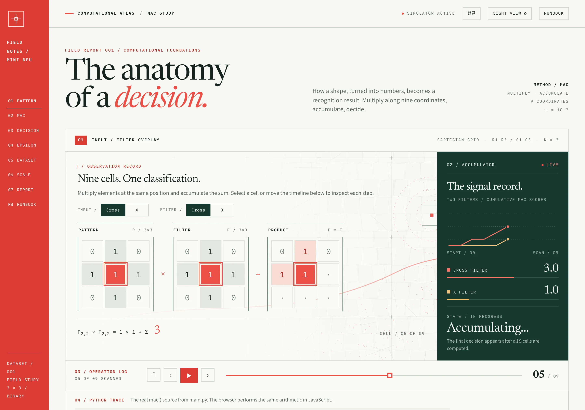
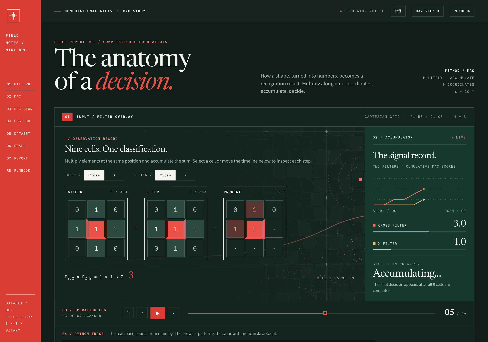
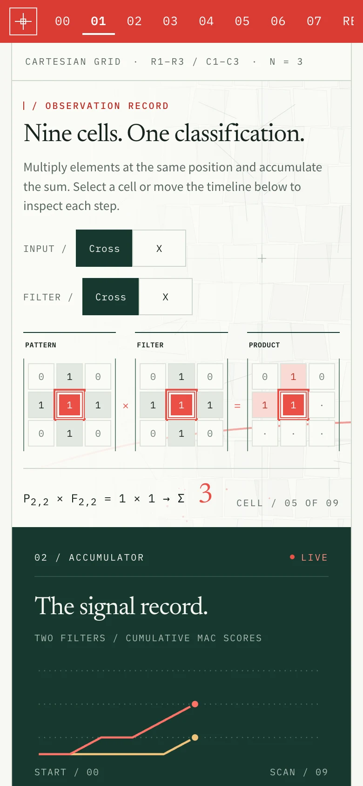
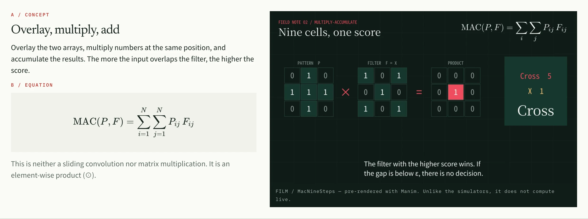
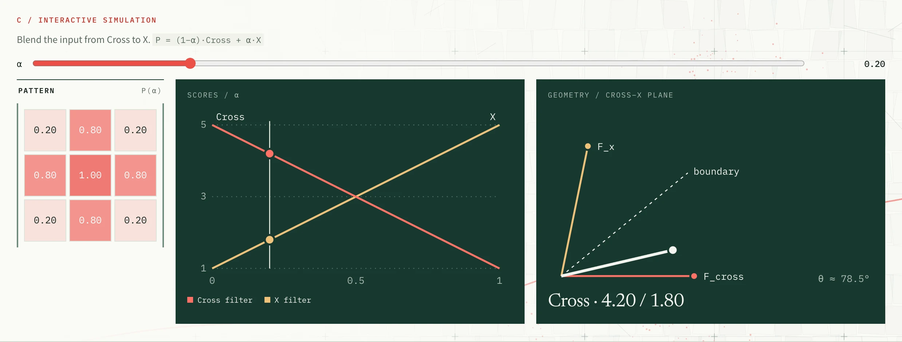
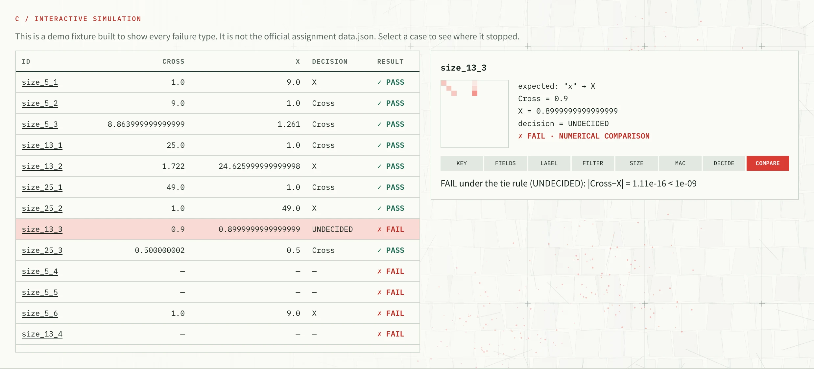
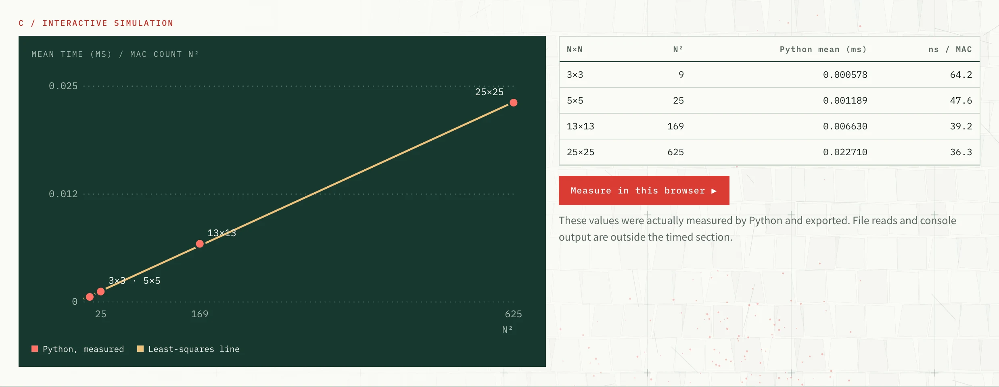
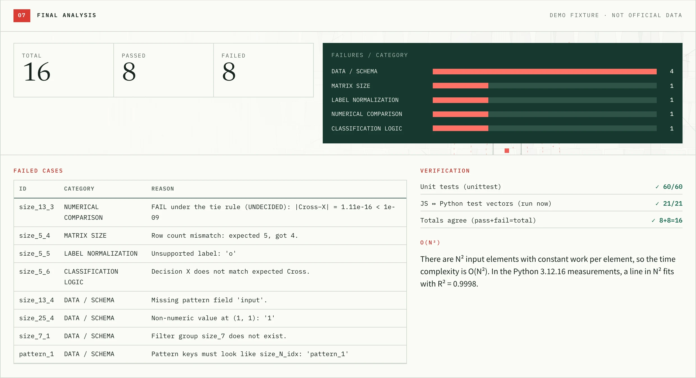
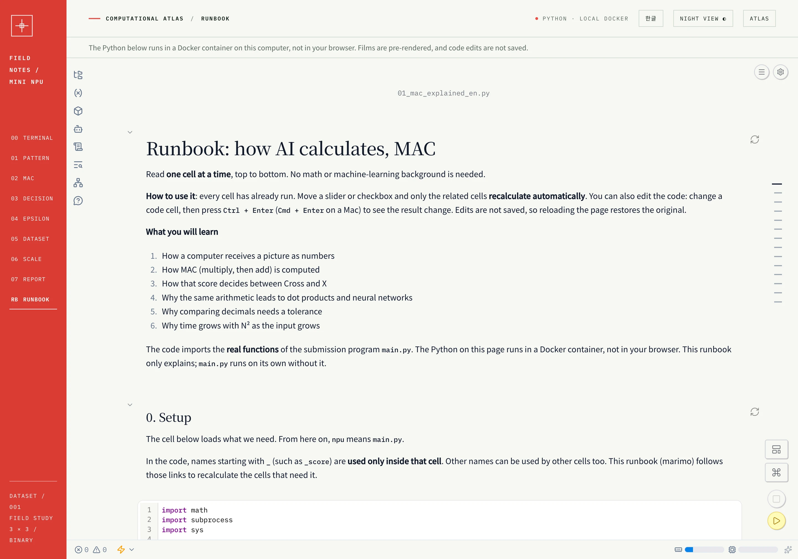
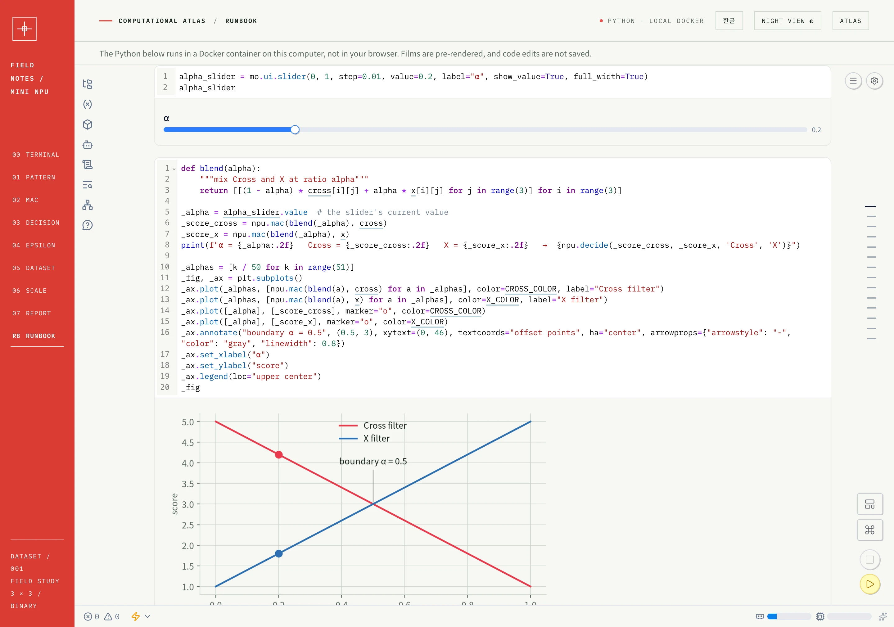

# Mini NPU: a small calculator that imitates how AI computes

[한국어](README.md) · **English**

A console program that compares numeric patterns from 3×3 to 25×25 against filters using **MAC (Multiply-Accumulate)** and decides between Cross and X. The repository holds two independent results.

| Result | Location | Requires |
|---|---|---|
| **A. Assignment program** | `main.py` | Python 3.8+, standard library only |
| **B. Rain Atlas learning material** (simulator, runbook, Manim films) | Docker image `jidoil/mini-npu-atlas` | Docker |

`main.py` does not import the web code, notebook tools or Manim. This repository holds only the code of A; B ships as an image, without its source. A works without ever pulling the image.

> **About the data**: the official `data.json` was not available, so the results here were measured on a hand-made **demo fixture**, `fixtures/sample_data.json`. They are not official results. Put the official file in the repository root as `data.json` and the program uses it first.

## Screens

Captured from the public image `jidoil/mini-npu-atlas:1.0.0`. The results shown come from the demo data.

### MAC simulator

| Day | Night |
|---|---|
|  |  |

On a phone, the matrices and the accumulator panel stack vertically.



### Chapters

**Concept, equation and Manim film.** The film is pre-rendered.



**Decision.** Blend the input from Cross to X and watch the scores and the decision boundary.



**Dataset.** Click a case to see the stage where it stopped.



**Performance.** Python measurements with a straight-line fit against N².



**Final analysis.** Failure categories and verification results.



### Runbook

Read one cell at a time inside the site. Move a slider and Python recalculates.

| Opening | Slider and chart |
|---|---|
|  |  |

## How to run

### The assignment program

```bash
python3 main.py                        # choose a mode from the menu
python3 main.py --mode 1               # Mode 1: type 3×3 matrices
python3 main.py --mode 2               # Mode 2: analyze data.json
python3 main.py --mode 2 --lang en     # English output
python3 main.py --mode 2 --data path.json

python3 -m unittest discover -s tests  # unit tests
```

- **Mode 1**: enter filter A, filter B and the pattern line by line, separated by spaces. A format error shows a message and asks for that matrix again. Typing `cross` or `x` on a line generates that array.
- **Mode 2**: reads `data.json` and prints per-case scores, decisions, PASS/FAIL, a performance table and a summary. If the file is missing, it uses the demo fixture and warns that this is not official data.

### Rain Atlas

```bash
docker compose up -d
```

The first run downloads the image (about 670 MiB compressed). It holds the site, the runbook, Manim and LaTeX.

| Address | Contents |
|---|---|
| http://localhost:8790 | Rain Atlas (Korean/English, Day/Night) |
| http://localhost:8790/runbook.html | The runbook, built into the site (marimo) |

To change the port, run `ATLAS_PORT=9000 docker compose up -d`. The runbook executes code without a token, so it is published on `127.0.0.1` only and nginx refuses requests coming from other sites. **Do not make it reachable from other machines.**

If the server restarts while a runbook is open, the runbook may open with its cells not yet run. Press the **Restart** button on the page.

| Task | Command |
|---|---|
| Console program | `docker compose run --rm cli` |
| Unit tests | `docker compose run --rm cli python -m unittest discover -s tests` |
| Stop | `docker compose down` |

## Runbook

The runbook opens **inside the site**, not in a separate window. Use `RB` on the Atlas rail or `RUNBOOK` in the top bar; language and Day/Night follow the Atlas. It is written so that anyone can follow it one cell at a time, with no math or machine-learning background.

- It goes from turning a picture into numbers through MAC, the dot product, the link to neural networks, floating point, dataset processing and time complexity, calling the real functions of `main.py`.
- It uses [marimo](https://marimo.io). Move a slider or checkbox and only the related cells recalculate, at once.
- Change a 3×3 input with checkboxes, watch the scores and decision, and render a Manim film of that input.
- The Python runs in a local Docker container, not in your browser. The container is read-only, so trying out code edits never changes the files in the image.

## Implementation summary

### MAC

Multiply the elements of input $P$ and filter $F$ at the same position and add everything up. This is neither a sliding convolution nor matrix multiplication.

```python
def mac(pattern, filter_matrix):
    n = len(pattern)
    score = 0.0
    for i in range(n):
        for j in range(n):
            score += pattern[i][j] * filter_matrix[i][j]
    return score
```

### Label normalization

Before comparing, every label becomes a canonical `Cross` or `X`. Surrounding spaces and letter case are ignored.

| Raw | Canonical |
|---|---|
| `+`, `cross` (expected, filter keys) | `Cross` |
| `x` (expected, filter keys) | `X` |
| anything else | no guessing: that case is recorded as FAIL |

### Epsilon policy

If `abs(a - b) < 1e-9`, the two scores count as equal and the result is `UNDECIDED`. In Mode 2, `UNDECIDED` can never match `expected`, so it is a FAIL. Decimals such as 0.1 are not stored exactly in binary, so `==` can call mathematically equal sums different.

### Data handling

N comes from the key (`size_13_2` → 13), which selects `filters["size_13"]`. Row counts, column counts and numeric values are checked, then MAC decides. An error in one case never stops the program: it becomes that case's FAIL with a reason.

## Result report

Environment: Docker `python:3.12-slim`, Python 3.12.16, Linux aarch64, 16 demo cases.

### Test results

- **60 unit tests pass** (Python 3.8.20, 3.12.16 and 3.14.10)
- JS and Python test vectors: **21/21 match**
- Demo data: **16 total, 8 passed, 8 failed**

### Failure analysis

The 8 failures were **put into the demo data on purpose**, to confirm that every failure type is handled correctly. That is why failures are not zero, and they are not errors in `main.py`.

| Case | Category | Cause | Where to fix |
|---|---|---|---|
| `size_13_3` | NUMERICAL COMPARISON | score gap 1.11e-16 is below ε, so UNDECIDED | data (intended tie) |
| `size_5_4` | MATRIX SIZE | 4 rows where 5 are required | data |
| `size_5_5` | LABEL NORMALIZATION | unsupported label `o` | data |
| `size_5_6` | CLASSIFICATION LOGIC | decided X, expected Cross | data or filter |
| `size_13_4` | DATA / SCHEMA | missing `input` field | data |
| `size_25_4` | DATA / SCHEMA | value at (1, 1) is the string `'1'` | data |
| `size_7_1` | DATA / SCHEMA | filter group `size_7` does not exist | data |
| `pattern_1` | DATA / SCHEMA | key is not in `size_N_idx` form | data |

- Splitting failures into five categories shows first whether the data or the code needs fixing.
- Schema errors lead with 4 only because of how the demo data was built; this says nothing about real data.
- Waving a label error through as a spelling difference could let wrong data PASS, so unknown values are never guessed.
- Assigning a tie to either label would let noise decide, so ties are kept apart as UNDECIDED.
- Computing on just the leading part of a wrongly sized input would quietly give a wrong score, so size is checked before MAC.
- A run on official data may fail differently, and this table must then be rewritten.

### Performance

The web page and the table below average 2000 runs per size to reduce noise. The console program averages the required 10, so its values vary more. File reads and console output are outside the timed section.

| Size | Operations N² | Mean time (ms) | Time per MAC (ns) |
|---|---:|---:|---:|
| 3×3 | 9 | 0.000578 | 64.2 |
| 5×5 | 25 | 0.001189 | 47.6 |
| 13×13 | 169 | 0.006630 | 39.2 |
| 25×25 | 625 | 0.022710 | 36.3 |

### Time complexity

- `mac()` does one multiply and one add per N×N element: **time O(N²)**, extra space O(1).
- One case compares against two filters, so 2N² multiplications, still O(N²).
- Fitting $T = a + b N^2$ gives $a = 3.55 \times 10^{-4}$ ms, $b = 3.59 \times 10^{-5}$ ms and **R² = 0.9998**, nearly a straight line.
- The log-log slope against $N$, however, is **1.75**, not the theoretical 2, because fixed costs $a$ such as the function call weigh more at small sizes. The per-MAC time in the table falls with size for the same reason.
- Going from 13×13 to 25×25, for example, theory predicts 3.70 times and the measurement shows 3.43 times.
- Theory gives the shape of growth; measurement adds the constants and noise. Values differ between computers and runs.

### Bonus

**1D optimization**: unrolling the matrix is still O(N²), but with a smaller constant because there is less indexing. It took 0.57 times as long at 3×3 and 0.83 times at 25×25 (mean of 2000 runs).

| Size | 2D (ms) | 1D (ms) | 1D/2D |
|---|---:|---:|---:|
| 3×3 | 0.000584 | 0.000332 | 0.57 |
| 5×5 | 0.001242 | 0.000683 | 0.55 |
| 13×13 | 0.006156 | 0.003856 | 0.63 |
| 25×25 | 0.020888 | 0.017414 | 0.83 |

**N×N pattern generator**: `make_cross(n)` and `make_x(n)` serve both Mode 1 input and the benchmark.

## Reproducibility

```bash
docker compose run --rm cli python -m unittest discover -s tests
docker compose run --rm cli python main.py --mode 2
```

- Scores, decisions and test results are always the same. Only times change between runs.
- Chapters 5–7 of the web page only display results exported with the real functions of `main.py` when the image was built; the browser does not run Python.
- To switch to official data, put `data.json` in the repository root and rerun `main.py`. The Atlas and runbook in the image keep showing the demo data.

## Layout

```text
main.py                 assignment program (standard library only)
tests/                  unit tests
fixtures/               demo data (not official)
tools/make_fixture.py   demo data generator
docker-compose.yml      runs the Rain Atlas image and the console program
docs/screenshots/       README screens
```

## Limitations

- Without the official `data.json`, the failure analysis and performance figures are based on demo data.
- The web design starts from the prototype `mini_npu_rain_atlas.html` and refines it while keeping its identity, so it is not identical to the original. Once running, the original is at http://localhost:8790/reference/mini_npu_rain_atlas.html.
- Some web fonts come from Google Fonts, so fallback fonts appear offline. Functions are unaffected.
- The source of the Atlas and runbook is not in this repository, so B cannot run without the image.
- The Manim films are pre-rendered, not live computation. The 25 MAC units in the film are an illustration, not a real chip's specification.
