# Mini NPU: AI가 계산하는 방식을 흉내 내는 작은 계산기

**한국어** · [English](README.en.md)

3×3부터 25×25까지의 숫자 패턴을 필터와 **MAC(Multiply-Accumulate)** 연산으로 비교해 Cross와 X를 판정하는 콘솔 프로그램입니다. 저장소에는 서로 독립된 두 가지 결과물이 있습니다.

| 결과물 | 위치 | 요구 사항 |
|---|---|---|
| **A. 과제 제출 프로그램** | `main.py` | Python 3.8 이상, 표준 라이브러리만 사용 |
| **B. Rain Atlas 학습 자료** (시뮬레이터, 터미널, 런북, Manim 영상) | Docker 이미지 `jidoil/mini-npu-atlas` | Docker |

`main.py`는 웹, 노트북 도구, Manim을 import하지 않습니다. 이 저장소에는 A의 코드만 있고, B는 소스 없이 이미지로 제공합니다. 이미지를 받지 않아도 A는 그대로 동작합니다.

> **데이터 안내**: 결과는 과제 제공 데이터 `data.json`(6개 케이스)으로 측정했습니다. 직접 만든 `fixtures/sample_data.json`(16개 케이스)은 다섯 가지 실패 유형을 확인하기 위한 데모이며 공식 데이터가 아닙니다.

## 화면

공개 이미지 `jidoil/mini-npu-atlas:1.2.0`에서 찍은 화면입니다. 표시된 결과는 제공 데이터 기준입니다.

### MAC 시뮬레이터

| Day | Night |
|---|---|
| 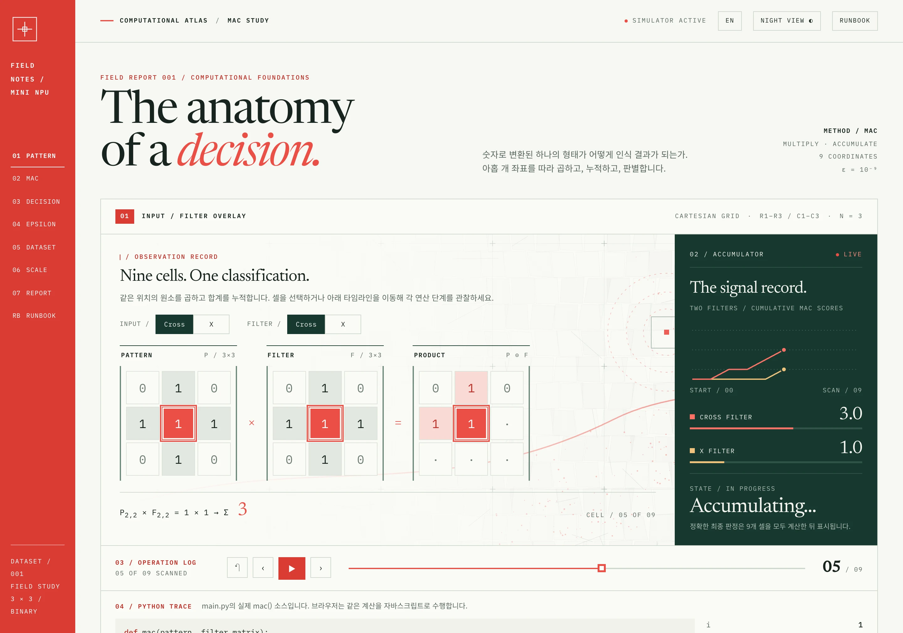 | 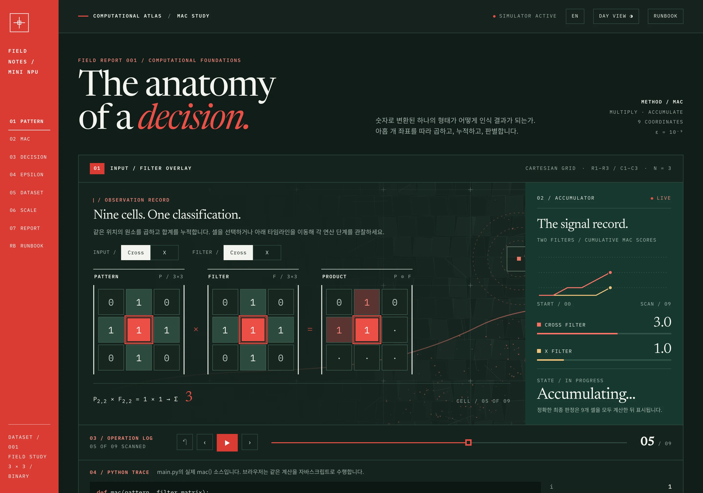 |

모바일에서는 행렬과 누적 패널이 위아래로 배치됩니다.

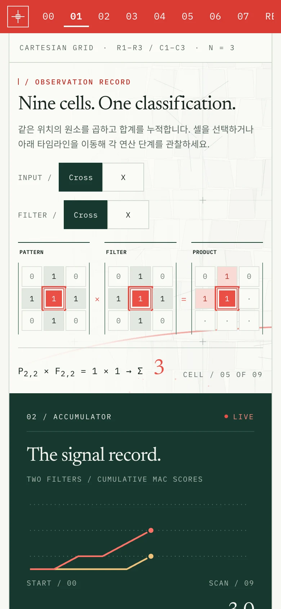

### 챕터

**개념, 수식, Manim 영상.** 영상은 미리 렌더링한 것입니다.

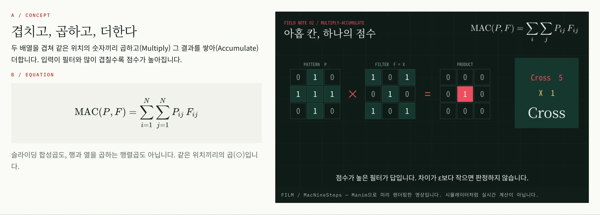

**판정.** 입력을 Cross에서 X로 섞으며 점수와 결정 경계를 관찰합니다.

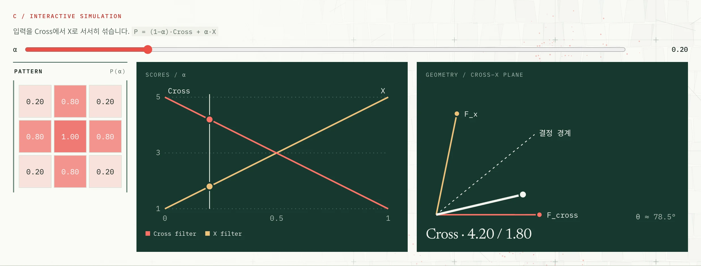

**데이터셋.** 케이스를 누르면 어느 단계에서 멈췄는지 보여 줍니다.

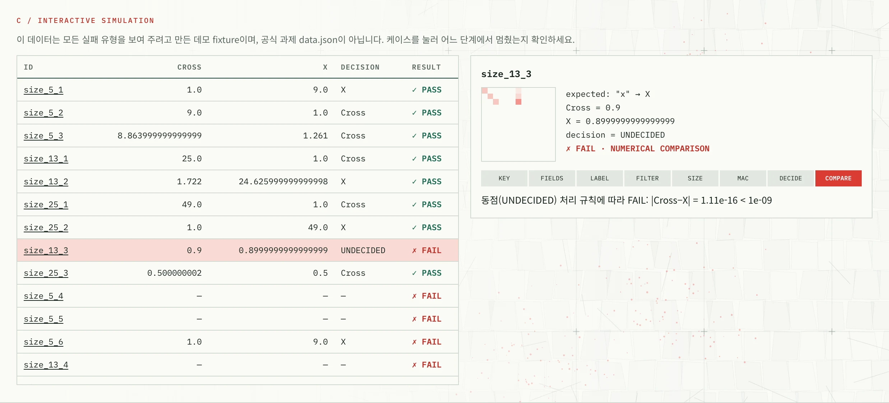

**성능.** 파이썬 실측값과 N²에 대한 직선 적합입니다.

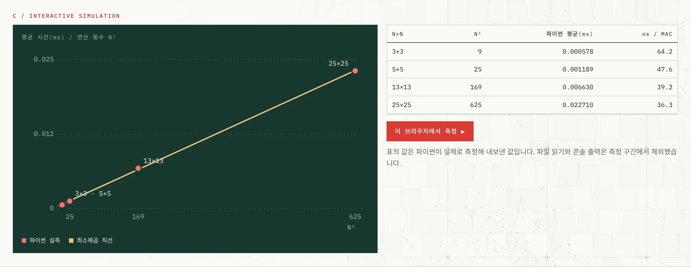

**최종 분석.** 실패 원인 분류와 검증 결과입니다.

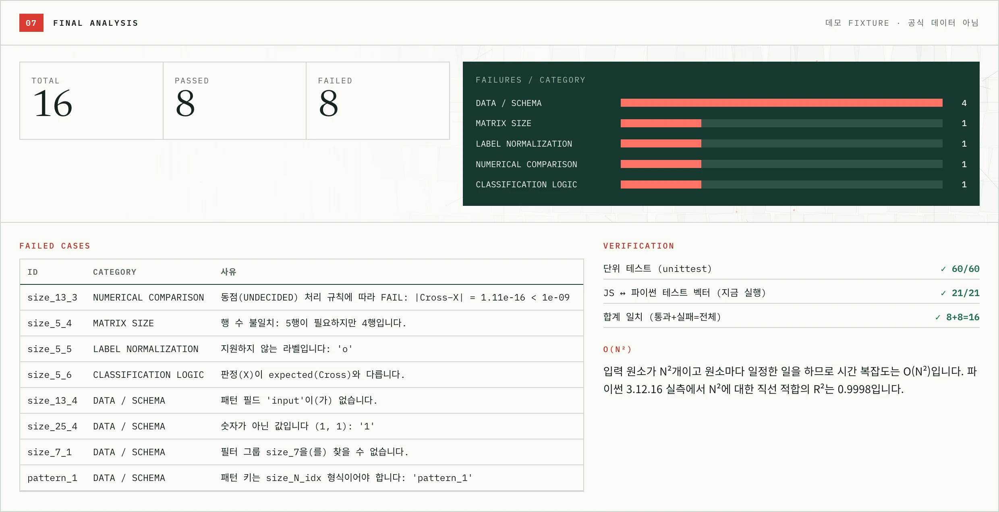

### 아키텍처

컨테이너 전체 구성, 터미널에서 도는 `main.py`의 실행 경로, 필터와 MAC, ε, 판정의 관계, 파일 구조를 한 페이지에 정리했습니다. 케이스를 고르면 제공 데이터의 실제 값이 계산 경로를 따라 표시됩니다.

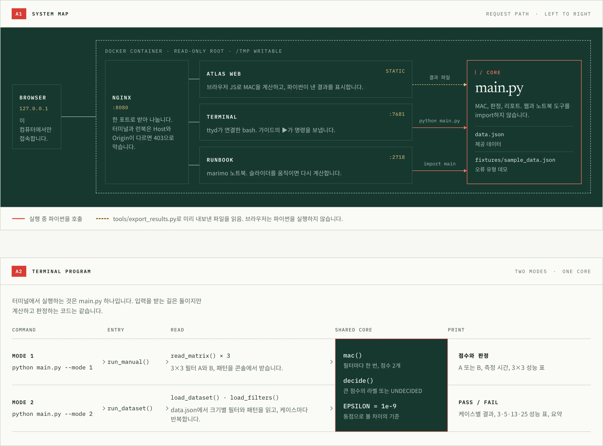

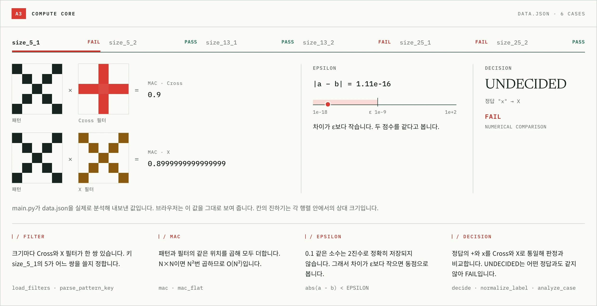

### 터미널

왼쪽의 실제 셸에서 과제 요구 사항을 직접 실행합니다. 오른쪽 가이드의 ▶를 누르면 명령이 셸로 전송되고, 단계별로 나와야 할 결과를 함께 보여 줍니다.

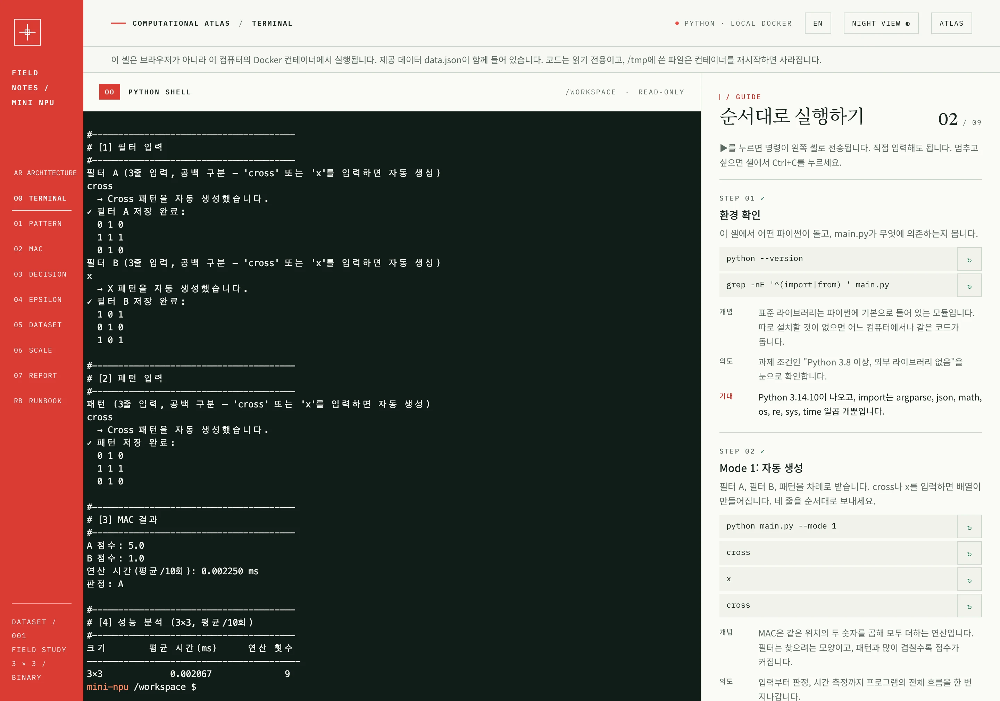

단위 테스트 단계는 테스트마다 무엇을 검사했는지와 결과, 묶음별 요약을 출력합니다.

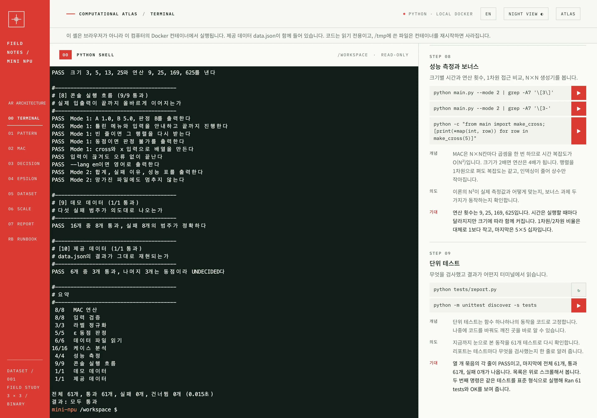

### 런북

사이트 안에서 한 셀씩 읽고, 슬라이더를 움직이면 파이썬이 다시 계산합니다.

| 처음 화면 | 슬라이더와 차트 |
|---|---|
| 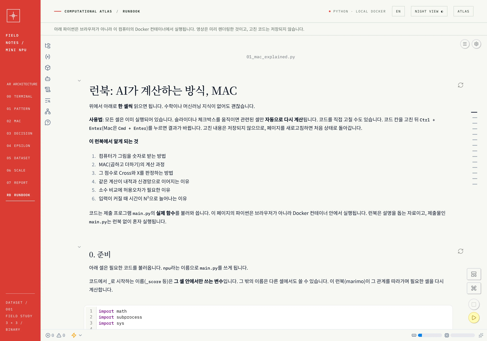 | 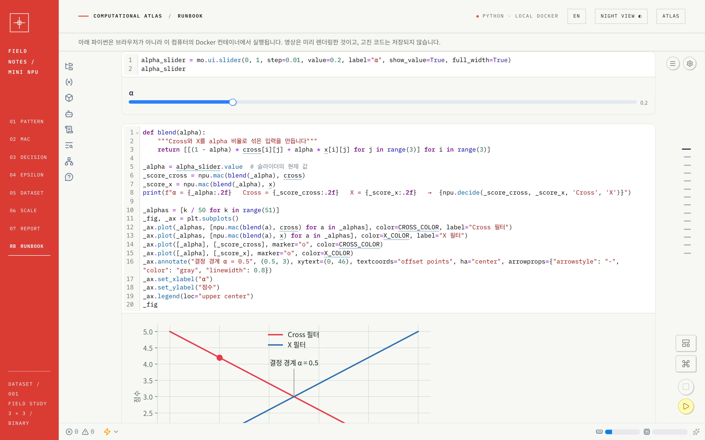 |

## 실행 방법

### 제출 프로그램

```bash
python3 main.py                        # 모드를 메뉴에서 선택
python3 main.py --mode 1               # Mode 1: 3×3 직접 입력
python3 main.py --mode 2               # Mode 2: data.json 분석
python3 main.py --mode 2 --lang en     # 영어 출력
python3 main.py --mode 2 --data 경로.json

python3 tests/report.py                # 단위 테스트: 무엇을 검사했고 결과가 어떤지 출력
python3 -m unittest discover -s tests  # 같은 테스트를 표준 형식으로 실행
```

- **Mode 1**: 필터 A, 필터 B, 패턴을 한 줄씩 공백으로 구분해 입력합니다. 형식이 틀리면 안내 후 그 행렬을 다시 입력받습니다. 줄에 `cross` 또는 `x`를 입력하면 해당 배열이 자동으로 만들어집니다.
- **Mode 2**: `data.json`을 읽어 케이스별 점수, 판정, PASS/FAIL, 성능 표, 요약을 출력합니다. 파일이 없으면 "공식 데이터 아님" 경고와 함께 데모 데이터를 사용합니다.

### Rain Atlas 실행

```bash
docker compose up -d
```

처음 실행할 때 이미지를 내려받습니다(압축 크기 약 670 MiB). 이미지에는 웹, 런북, Manim, LaTeX가 모두 들어 있습니다.

| 주소 | 내용 |
|---|---|
| http://localhost:8790 | Rain Atlas (한/영, Day/Night 전환) |
| http://localhost:8790/architecture.html | 시스템, 계산 경로, 파일 구조 |
| http://localhost:8790/terminal.html | 브라우저 안의 셸과 순서별 가이드 (ttyd) |
| http://localhost:8790/runbook.html | 사이트 안에 내장된 런북 (marimo) |

포트를 바꾸려면 `ATLAS_PORT=9000 docker compose up -d`를 사용합니다. 터미널과 런북은 토큰 없이 코드를 실행하므로 `127.0.0.1`에만 공개하고, nginx가 다른 사이트에서 오는 요청을 막습니다. **다른 컴퓨터에서 접근 가능하게 바꾸지 마세요.**

런북을 연 채로 서버를 재시작하면 셀이 실행되지 않은 상태로 열릴 수 있습니다. 이때는 화면의 **Restart** 버튼을 누르세요.

| 작업 | 명령 |
|---|---|
| 콘솔 프로그램 | `docker compose run --rm cli` |
| 단위 테스트 리포트 | `docker compose run --rm cli python tests/report.py` |
| 종료 | `docker compose down` |

## 터미널

왼쪽 레일의 `00`이나 상단 `TERMINAL`을 누르면 열립니다. 환경 확인, Mode 1, Mode 2, 판정 규칙, 성능 측정, 단위 테스트까지 아홉 단계를 순서대로 실행합니다.

- 터미널의 `data.json`은 제공 데이터입니다. 단계마다 개념, 의도, 기대 결과를 함께 설명합니다.
- 단위 테스트 단계는 테스트마다 무엇을 검사했는지와 PASS/FAIL, 묶음별 요약을 출력합니다.
- 셸은 브라우저가 아니라 로컬 Docker 컨테이너에서 실행됩니다.
- 코드는 읽기 전용이고, `/tmp`에 쓴 파일은 컨테이너를 재시작하면 사라집니다.
- 페이지를 새로 고치면 셸 세션과 진행 표시가 처음으로 돌아갑니다. 언어를 바꿔도 셸 세션은 유지됩니다.

## 런북

런북은 별도 창이 아니라 **사이트 안에서** 열립니다. Atlas의 왼쪽 레일 `RB`나 상단 `RUNBOOK`을 누르면 되고, 언어와 Day/Night 전환도 Atlas와 함께 움직입니다. 수학이나 머신러닝 지식이 없어도 위에서 아래로 한 셀씩 읽으며 따라가도록 만들었습니다.

- 그림을 숫자로 바꾸는 과정부터 MAC, 내적, 신경망과의 연결, 부동소수점, 데이터셋 처리, 시간 복잡도까지 다루며 `main.py`의 실제 함수를 호출합니다.
- [marimo](https://marimo.io)를 사용합니다. 슬라이더나 체크박스를 움직이면 관련된 셀만 바로 다시 계산됩니다.
- 3×3 입력을 체크박스로 바꿔 점수와 판정을 보고, 그 입력으로 Manim 영상을 직접 렌더링할 수 있습니다.
- 파이썬은 브라우저가 아니라 로컬 Docker 컨테이너에서 실행됩니다. 컨테이너는 읽기 전용이어서, 코드를 고쳐 봐도 이미지 안의 파일은 바뀌지 않습니다.

## 구현 요약

### MAC

입력 $P$와 필터 $F$의 같은 위치 원소를 곱해 모두 더합니다. 필터를 움직이는 합성곱도, 행렬곱도 아닙니다.

$$\text{score} = \sum_{i=1}^{N} \sum_{j=1}^{N} P_{ij} F_{ij}$$

원소를 읽어 곱하고, 누적 변수에 더하고, 끝나면 그 값을 반환합니다. 점수의 의미는 [설계 해설](#설계-해설)에 있습니다.

```python
def mac(pattern, filter_matrix):
    n = len(pattern)
    score = 0.0
    for i in range(n):
        for j in range(n):
            score += pattern[i][j] * filter_matrix[i][j]
    return score
```

### 라벨 정규화

비교 전에 모든 라벨을 표준 라벨 `Cross`와 `X`로 바꿉니다. 앞뒤 공백과 대소문자는 무시합니다.

| 원본 | 표준 라벨 |
|---|---|
| `+`, `cross` (expected, 필터 키) | `Cross` |
| `x` (expected, 필터 키) | `X` |
| 그 밖의 값 | 추측하지 않고 해당 케이스를 FAIL로 기록 |

라벨 규칙을 `normalize_label` 함수 하나로 분리했기 때문에 `expected`와 필터 키가 같은 규칙을 쓰고, 표기를 추가하거나 테스트할 곳도 하나입니다.

### Epsilon 정책

`abs(a - b) < 1e-9`이면 두 점수를 같다고 보고 `UNDECIDED`(판정 불가)를 반환합니다. Mode 2에서 `UNDECIDED`는 `expected`와 일치할 수 없으므로 FAIL입니다. 0.1 같은 소수는 2진수로 정확히 저장되지 않아 `==`로 비교하면 수학적으로 같은 합도 다르게 판정되기 때문입니다.

- **값의 근거**: 제공 데이터에서 동점 케이스의 차이는 최대 2.66e-15이고, 실제로 갈리는 케이스의 차이는 최소 8.8입니다. 1e-9는 그 사이에 넉넉히 들어갑니다.
- **값 변경**: `main.py`의 상수 `EPSILON`을 고칩니다. `decide()`는 `epsilon` 인자도 받습니다. 명령행 옵션은 없습니다.
- **Mode별 처리**: Mode 1은 사람이 직접 보는 결과이므로 "판정 불가"로 알리고, Mode 2는 정답과 비교하는 평가이므로 FAIL로 집계합니다.

### 데이터 처리

키에서 N을 추출(`size_13_2` → 13)하고 `filters["size_13"]`을 찾습니다. 행과 열 수, 숫자 여부를 검사한 뒤 MAC으로 판정합니다. 한 케이스의 오류는 프로그램을 멈추지 않고 해당 케이스의 FAIL과 사유로 기록됩니다.

키 형식은 필터 그룹 `size_N`, 패턴 `size_N_idx`입니다. N은 1 이상의 정수, idx는 비어 있지 않은 문자열입니다(`size_13_2`, `size_5_a`). `pattern_1`, `size_x_1`, `size_0_1`은 DATA / SCHEMA FAIL입니다.

## 설계 해설

### MAC 점수가 유사도를 뜻하는 이유

행렬을 한 줄로 펴면 MAC은 두 벡터의 **내적**입니다.

$$\text{score} = \sum_{i,j} P_{ij} F_{ij} = \mathbf{p} \cdot \mathbf{f} = \|\mathbf{p}\| \, \|\mathbf{f}\| \cos\theta$$

$\cos\theta$는 두 벡터의 방향이 얼마나 같은지를 나타냅니다. 모양이 같으면 1에 가깝고, 겹치는 칸이 없으면 0입니다. 같은 패턴을 두 필터와 비교할 때 $\|\mathbf{p}\|$는 같으므로, 두 필터의 크기 $\|\mathbf{f}\|$도 같다면 **점수가 높은 쪽이 패턴과 더 닮은 필터**입니다. 0과 1로 된 행렬에서는 점수가 곧 겹치는 칸의 수입니다. 3×3 Cross는 자기 자신과 5칸, X와는 가운데 1칸이 겹칩니다.

다만 MAC은 크기를 나누지 않으므로 가중치가 큰 필터가 그만큼 높은 점수를 받습니다. 제공 데이터의 필터는 크기가 크게 다르며(`size_5`: Cross 2.97, X 0.30), 동점 3건이 여기서 나옵니다.

| 케이스 | 정답 | MAC: Cross, X | 코사인: Cross, X | 코사인이 고르는 라벨 |
|---|---|---|---|---|
| `size_5_1` | X | 0.9, 0.9 | 0.101, 1.000 | X |
| `size_13_2` | Cross | 7.5, 7.5 | 1.000, 0.196 | Cross |
| `size_25_1` | X | 4.9, 4.9 | 0.083, 1.000 | X |

MAC 값은 분수로 계산한 정확한 값입니다. 코사인으로 비교하면 6건 모두 정답과 일치하지만 이는 별도로 계산한 분석입니다. `main.py`는 과제 규칙대로 정규화하지 않은 MAC과 ε으로 판정합니다.

### 새 라벨을 추가하는 절차

**같은 라벨의 새 표기** (예: `×`를 X로)

1. `main.py`의 `LABEL_ALIASES`에 `"×": X`를 추가합니다. 비교 전에 공백을 지우고 소문자로 바꾸므로 키는 소문자로 씁니다.
2. `test_required_mappings`에 새 표기를 넣습니다. `test_unsupported_labels`에 있던 값(`plus`, `o` 등)을 허용한다면 거기서 뺍니다.
3. `python3 tests/report.py`와 `python3 main.py --mode 2`로 확인합니다.

**새 분류** (예: T 모양)

1. 상수 `T`와 라벨 목록 `LABELS`를 만들고 `LABEL_ALIASES`에 표기를 추가합니다.
2. `load_filter_group`의 `{CROSS, X}` 검사를 `LABELS`로 바꿉니다.
3. `evaluate_case`가 필터마다 점수를 내어 라벨별 사전으로 돌려주게 합니다.
4. `analyze_case`에서 모든 점수의 유한성을 검사하고, 상위 두 점수를 `decide`에 넘깁니다. 이 둘이 ε 안이면 UNDECIDED입니다.
5. `print_case`와 Cross, X를 직접 적은 메시지(`filter_ok`, `r_group_labels`, `r_tie`, `r_nonfinite_score`)를 고칩니다.
6. 데이터의 모든 `size_N` 그룹에 새 필터를 넣습니다. 빠진 크기의 케이스는 DATA / SCHEMA FAIL이 됩니다.
7. 테스트 데이터에 새 필터를 넣고, 새 분류의 테스트와 `tests/report.py`의 설명을 추가합니다.

임시 복사본에서 두 절차를 모두 해 보았습니다. 표기 추가는 61개 테스트가 그대로 통과했습니다. T를 추가한 3분류는 5×5의 T, X, Cross 패턴을 모두 맞게 판정했고, 필터가 두 개인 테스트 데이터 때문에 7번 전에는 14개 테스트가 실패했습니다. 제출 코드는 과제대로 Cross와 X 두 분류입니다. Docker 이미지의 웹 화면도 두 점수를 전제로 하므로 따로 고쳐야 합니다.

### 1000×1000으로 커지면

`python3 tools/measure_large.py`로 케이스 하나를 단계별로 측정했습니다(Python 3.12.16, Linux aarch64, 3회 평균, 값은 실행마다 달라집니다).

| 단계 | 시간(ms) | 비중 |
|---|---:|---:|
| JSON 파싱, 행렬 3개 | 306.0 | 32.4% |
| `validate_matrix` × 3 | 532.9 | 56.4% |
| `mac` × 2 | 105.9 | 11.2% |
| `decide` | 0.006 | 0.0% |
| 합계 | 944.7 | |

**병목은 곱셈이 아니라 입력 처리입니다.** 메모리도 JSON 문자열 14.3 MiB를 파싱하는 동안 최대 94 MiB를 씁니다. 파이썬 리스트의 칸마다 부동소수점 객체가 따로 있기 때문입니다. 개선한다면 다음 순서입니다.

| 순서 | 방법 | 근거 |
|---|---:|---|
| 1 | JSON 대신 이진 배열로 입력 | 파싱 시간 제거. `array('d')`면 행렬 3개가 22.9 MiB (계산값) |
| 2 | 필터는 크기별로 한 번만 읽고 검증 | 케이스가 많을수록 효과가 큼. `load_filters`가 이미 이렇게 동작 |
| 3 | 필터의 0이 아닌 칸만 곱하기 | Cross 필터는 100만 칸 중 3996칸. 47.6 ms → 0.362 ms |
| 4 | 1차원 연속 배치와 내장 함수 | 2차원 48.2 ms → 1차원 38.6 ms → `sum(map(mul))` 24.6 ms |
| 5 | C로 구현된 벡터 연산 | `math.sumprod` 9.0 ms. Python 3.12 이상이라 3.8 조건의 제출 코드에는 넣지 않음 |
| 6 | 행 단위 블록으로 나눠 프로세스 병렬 처리 | 스레드는 GIL 때문에 이 계산을 빠르게 하지 못함. 복사 비용이 있음 (미측정) |

**수치 정책도 함께 바뀌어야 합니다.** 같은 곱들을 역순으로 더하면 정확한 합은 같아야 하지만, 1000×1000에서는 차이가 **3.81e-09**로 ε을 넘어 실제 동점을 A로 판정했습니다. 100×100에서는 4.55e-12로 ε 안이었습니다. 오차는 더하는 횟수와 점수 크기를 따라 커지므로, 이 규모에서는 `math.fsum`(이 실험에서 차이 0)이나 `math.isclose` 같은 상대 허용 오차가 필요합니다.

### CPU와 NPU의 차이

이 프로그램은 CPU에서만 실행되며, NPU 항목은 측정이 아닌 설명입니다.

| | CPU (이 프로그램) | NPU |
|---|---|---|
| 실행 방식 | 한 코어가 곱셈과 덧셈을 하나씩 직렬로 | MAC 유닛 $P$개가 같은 사이클에 병렬로 |
| 1000×1000 MAC 한 번 | $N^2 \times t$. 실측 48 ms | 약 $N^2 / P$ 사이클 + 데이터 이동 |
| 주된 병목 | 인터프리터 비용과 흩어진 객체 접근 | 메모리 대역폭과 온칩 메모리 크기 |

- **CPU 병목의 크기**: 같은 CPU에서 `mac()`은 48 ms, C로 구현된 `math.sumprod`는 9 ms입니다. 곱셈 자체보다 파이썬이 칸마다 하는 일이 시간을 씁니다.
- **NPU 병목의 크기**: 예를 들어 $P = 1024$, 1 GHz, 8비트 값이라고 가정하면 계산은 977 사이클, 약 1 µs입니다. 대신 사이클마다 2 KB의 값을 공급해야 하므로 외부 메모리에서 직접 읽는다면 약 2 TB/s가 필요합니다. 그래서 NPU는 필터와 입력을 유닛 가까운 온칩 메모리에 둡니다. 이 수치는 설명용 계산이며 실제 칩의 사양이 아닙니다.
- **MAC만 빨라져서는 부족합니다**: 위 표에서 MAC은 11.2%이므로, MAC을 무한히 빠르게 해도 이 케이스는 최대 약 1.13배만 빨라집니다(암달의 법칙). NPU의 효과를 얻으려면 입력 준비와 데이터 이동도 함께 줄여야 합니다.

## 결과 리포트

측정 환경: Docker `python:3.12-slim`, Python 3.12.16, Linux aarch64, 제공 데이터 `data.json` 6케이스.

### 테스트 결과

- 단위 테스트 **61개 통과** (Python 3.8.20, 3.12.16, 3.14.10). `python3 tests/report.py`로 테스트별 내용과 결과를 볼 수 있습니다.
- JS와 Python 테스트 벡터 **21/21 일치**
- 제공 데이터 **전체 6, 통과 3, 실패 3**
- 데모 데이터 **전체 16, 통과 8, 실패 8** (의도한 결과)

### 제공 데이터 결과

| 케이스 | Cross 점수 | X 점수 | 판정 | 정답 | 결과 |
|---|---:|---:|---|---|---|
| `size_5_1` | 0.9 | 0.8999999999999999 | UNDECIDED | X | FAIL |
| `size_5_2` | 8.9 | 0.1 | Cross | Cross | PASS |
| `size_13_1` | 0.3 | 14.700000000000008 | X | X | PASS |
| `size_13_2` | 7.499999999999997 | 7.5 | UNDECIDED | Cross | FAIL |
| `size_25_1` | 4.9 | 4.899999999999999 | UNDECIDED | X | FAIL |
| `size_25_2` | 52.9 | 0.1 | Cross | Cross | PASS |

### 실패 원인 분석

제공 데이터의 실패 3건은 모두 **NUMERICAL COMPARISON**입니다.

| 케이스 | 두 점수의 차이 | 원인 | `>`만 썼다면 |
|---|---:|---|---|
| `size_5_1` | 1.11e-16 | 차이가 ε 미만이어서 UNDECIDED | Cross (정답 X와 다름) |
| `size_13_2` | 2.66e-15 | 차이가 ε 미만이어서 UNDECIDED | X (정답 Cross와 다름) |
| `size_25_1` | 1.78e-15 | 차이가 ε 미만이어서 UNDECIDED | Cross (정답 X와 다름) |

- 입력을 `fractions.Fraction`으로 다시 계산하면 세 케이스 모두 두 점수가 **정확히 같습니다.** 눈에 보이는 차이는 부동소수점 오차입니다.
- `>`로만 비교했다면 오차의 방향이 라벨을 정해 세 건 모두 틀린 라벨이 나왔을 것입니다.
- 프로그램은 ε = 1e-9 규칙대로 동점을 UNDECIDED로 처리하고, UNDECIDED는 어떤 정답과도 같지 않으므로 FAIL로 기록합니다. 이 3건을 FAIL로 두는 것이 출제 의도와 같은지는 확인하지 못했습니다.

**데모 데이터의 실패 8건**은 모든 실패 유형이 올바르게 처리되는지 확인하려고 `fixtures/sample_data.json`에 **일부러 넣은 것**입니다.

| 케이스 | 분류 | 원인 | 고칠 곳 |
|---|---|---|---|
| `size_13_3` | NUMERICAL COMPARISON | 두 점수 차이 1.11e-16이 ε 미만이어서 UNDECIDED | 데이터 (의도된 동점) |
| `size_5_4` | MATRIX SIZE | 5행이 필요한데 4행 | 데이터 |
| `size_5_5` | LABEL NORMALIZATION | 지원하지 않는 라벨 `o` | 데이터 |
| `size_5_6` | CLASSIFICATION LOGIC | 판정 X, expected Cross | 데이터 또는 필터 |
| `size_13_4` | DATA / SCHEMA | `input` 필드 없음 | 데이터 |
| `size_25_4` | DATA / SCHEMA | (1, 1) 값이 숫자가 아닌 문자열 `'1'` | 데이터 |
| `size_7_1` | DATA / SCHEMA | 필터 그룹 `size_7` 없음 | 데이터 |
| `pattern_1` | DATA / SCHEMA | 키가 `size_N_idx` 형식이 아님 | 데이터 |

- 실패를 다섯 분류로 나누면 데이터와 코드 중 어디를 고칠지 먼저 가릴 수 있습니다.
- 라벨 오류를 표기 차이로 넘기면 틀린 데이터가 PASS가 될 수 있어, 모르는 값은 추측하지 않습니다.
- 동점을 임의로 한쪽 라벨로 처리하면 잡음이 판정을 결정하므로 UNDECIDED로 분리합니다.
- 크기가 다른 입력을 앞부분만 잘라 계산하면 틀린 점수가 조용히 나옵니다. 그래서 MAC 전에 크기를 검사합니다.

### 성능 측정

웹과 아래 표는 측정 잡음을 줄이려고 크기당 2000회를 평균했습니다. 콘솔 프로그램은 과제 기준인 10회를 평균하므로 값이 더 흔들립니다. 측정 구간은 `mac()` 호출뿐이며, 파일 읽기, JSON 파싱, 입력 검증, `print` 출력은 제외했습니다.

| 크기 | 연산 횟수 N² | 평균 시간(ms) | MAC당 시간(ns) |
|---|---:|---:|---:|
| 3×3 | 9 | 0.000679 | 75.4 |
| 5×5 | 25 | 0.001416 | 56.6 |
| 13×13 | 169 | 0.007265 | 43.0 |
| 25×25 | 625 | 0.025275 | 40.4 |

### 시간 복잡도

- `mac()`은 N×N 원소마다 곱셈과 덧셈을 한 번씩 하므로 **시간 O(N²)**, 추가 공간 O(1)입니다.
- 케이스 하나는 필터 두 개와 비교하므로 2N²번 곱하며, 차수는 그대로 O(N²)입니다.
- 실측값에 $T = a + b N^2$를 맞추면 $a = 4.14 \times 10^{-4}$ ms, $b = 3.98 \times 10^{-5}$ ms, **R² = 0.9999**로 거의 직선입니다.
- 다만 $N$에 대한 로그-로그 기울기는 이론값 2가 아니라 **1.71**입니다. 함수 호출 같은 고정 비용 $a$의 비중이 작은 크기에서 크기 때문입니다. 위 표에서 MAC당 시간이 크기가 커질수록 줄어드는 것도 같은 이유입니다.
- 예를 들어 13×13에서 25×25로 커지면 이론상 3.70배이고 실측은 3.48배입니다.
- 이론은 증가의 형태를 말하고, 실측은 그 위의 상수와 잡음까지 보여 줍니다. 값은 컴퓨터와 실행 시점에 따라 달라집니다.

### 보너스

**1차원 최적화**: 행렬을 한 줄로 펴서 곱하면 같은 O(N²)이지만 상수가 줄어듭니다. 인덱스 계산이 줄기 때문입니다. 3×3에서 0.60배, 25×25에서 0.84배 시간이 걸렸습니다(2000회 평균).

| 크기 | 2차원(ms) | 1차원(ms) | 1차원/2차원 |
|---|---:|---:|---:|
| 3×3 | 0.000706 | 0.000421 | 0.60 |
| 5×5 | 0.001428 | 0.000823 | 0.58 |
| 13×13 | 0.007335 | 0.004647 | 0.63 |
| 25×25 | 0.025078 | 0.020991 | 0.84 |

**N×N 패턴 생성기**: `make_cross(n)`, `make_x(n)`을 Mode 1 입력과 성능 측정에 함께 씁니다.

## 재현성

```bash
docker compose run --rm cli python tests/report.py
docker compose run --rm cli python main.py --mode 2
```

- 점수, 판정, 테스트 결과는 항상 같습니다. 시간 값만 실행마다 달라집니다.
- 웹의 5~7장과 Architecture의 COMPUTE CORE는 `main.py`의 실제 함수로 미리 내보낸 결과를 보여 줄 뿐, 브라우저에서 Python을 실행하지 않습니다.
- 다른 파일을 분석하려면 `python3 main.py --mode 2 --data 경로.json`을 사용합니다. 이미지 안의 Atlas와 런북은 제공 데이터 결과를 보여 줍니다.

## 구조

```text
main.py                 제출 프로그램 (표준 라이브러리만 사용)
data.json               과제 제공 데이터
tests/test_mini_npu.py  단위 테스트
tests/report.py         테스트별 내용과 결과 출력
fixtures/               데모 데이터 (공식 데이터 아님)
tools/make_fixture.py   데모 데이터 생성
tools/measure_large.py  큰 행렬의 단계별 시간 측정
docker-compose.yml      Rain Atlas 이미지 실행, 콘솔 프로그램 실행
docs/screenshots/       README 화면
```

## 한계

- 제공 데이터의 실패 3건이 출제 의도와 같은지는 확인하지 못했습니다. 동점 처리 근거는 위 실패 원인 분석에 있습니다.
- 웹 디자인은 프로토타입 `mini_npu_rain_atlas.html`에서 출발해 정체성을 유지하면서 다듬었으므로 원본과 같지 않습니다. 원본은 실행 후 http://localhost:8790/reference/mini_npu_rain_atlas.html 에서 볼 수 있습니다.
- 웹 글꼴 일부는 Google Fonts에서 받으므로 오프라인에서는 대체 글꼴로 표시됩니다. 기능에는 영향이 없습니다.
- 터미널은 공식 릴리스 `ttyd` 1.7.7 바이너리를 빌드할 때 SHA-256으로 확인해 이미지에 넣습니다. 직접 작성한 코드가 아닙니다.
- Atlas와 런북의 소스는 이 저장소에 없으므로, 이미지 없이는 B를 실행할 수 없습니다.
- Manim 영상은 미리 렌더링한 것이며 실시간 계산이 아닙니다. 영상의 25 MAC 유닛은 설명용이며 실제 칩의 사양이 아닙니다.
